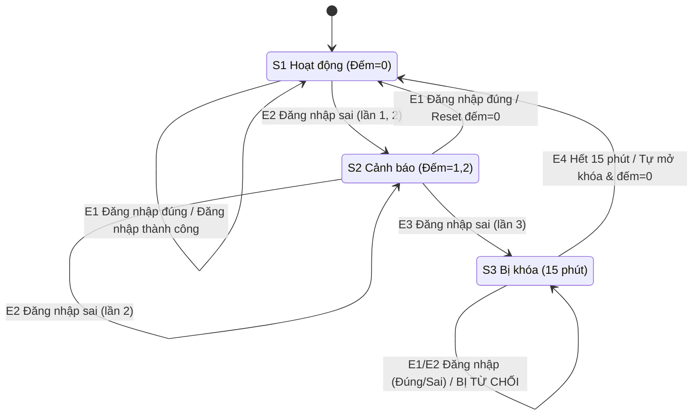

# BUỔI 2 – CHUYỂN TRẠNG THÁI: ĐĂNG NHẬP VÀ KHÓA TÀI KHOẢN
- **Họ tên:**Phạm Nguyễn Minh Luân
- **MSSV:**65131848
- **Yêu cầu liên quan:** FR-02.1, FR-02.2, FR-02.3, FR-02.4

## 1. Trạng thái và sự kiện

| Ký hiệu | Trạng thái | Mô tả |
|---|---|---|
| S1 | Hoạt động (Bộ đếm = 0) | Tài khoản ở trạng thái bình thường, chưa sai mật khẩu lần nào hoặc vừa được reset |
| S2 | Cảnh báo (Bộ đếm = 1, 2) | Tài khoản đã nhập sai mật khẩu 1 hoặc 2 lần liên tiếp |
| S3 | Bị khóa (Bộ đếm = 3) | Tài khoản bị tạm khóa trong 15 phút do nhập sai 3 lần liên tiếp |

| Ký hiệu | Sự kiện |
|---|---|
| E1 | Đăng nhập đúng mật khẩu |
| E2 | Đăng nhập sai mật khẩu (chưa đủ 3 lần) |
| E3 | Đăng nhập sai mật khẩu lần thứ 3 liên tiếp |
| E4 | Hết thời gian chờ 15 phút |

## 2. Sơ đồ chuyển trạng thái

Điền vào khối dưới đây. GitHub sẽ tự vẽ sơ đồ trong Pull Request.

## 3. Bảng chuyển đổi

Điền trạng thái đích cho mọi ô. Ô nào là chuyển đổi bị từ chối hoặc không hợp lệ thì ghi rõ trong cột ghi chú.

| Trạng thái hiện tại | E1 | E2 | E3 | Ghi chú |
|---|---|---|---|---|
| S1 |S1 |S2 |N/A |Nhập sai lần 1 chuyển sang S2 (đếm=1) |
| S2 |S1 |S2 |S3 |Đúng MK -> S1 (đếm về 0). Sai lần 3 -> S3 |
| S3 |S3(Bị từ chối) |S3(bị từ chối) |N/A |Mọi đăng nhập ở S3 đều bị từ chối với thông báo khóa 15p |

## 4. Ánh xạ sang ca kiểm thử

| Chuyển đổi | Hợp lệ? | Mã ca |
|---|---|---|
|S1 --(E1)--> S1 |Có |TC-65131848-21 |
|S1 --(E2)--> S2 |Có |TC-65131848-22 |
|S2 --(E1)--> S1 |Có |TC-65131848-23 |
|S2 --(E2)--> S2 |Có |TC-65131848-24 |
|S2 --(E3)--> S3 |Có |TC-65131848-25 |
|S3 --(E4)--> S1 |Có |TC-65131848-26 |
|S3 --(E1)--> S3 |Không (Bị từ chối) |TC-65131848-27 |
|S3 --(E2)--> S3 |Không (Bị từ chối) |TC-65131848-28 |

Số chuyển đổi hợp lệ: 6 · Số chuyển đổi đã phủ: 6 · Độ phủ: 100%
Số ca cho chuyển đổi không hợp lệ: 2
